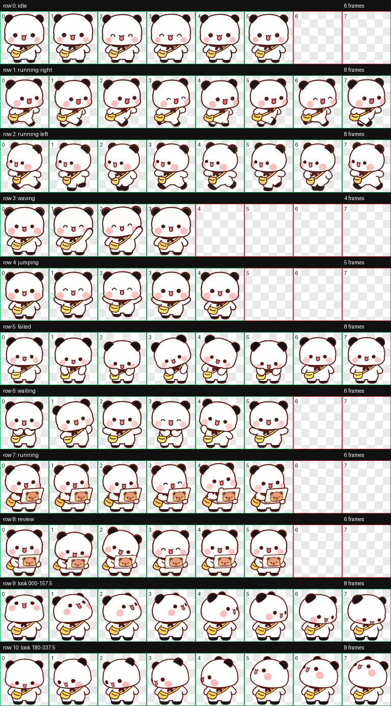

# 小黄包一二 · Codex 桌面宠物

斜挎小黄包的一二，戴着围巾，迈着黑色小脚。工作时会拿出小电脑，电脑背面贴着布布 wink 大头照。

A Yier companion for the Codex desktop app, with a yellow crossbody bag, a scarf and a Bubu wink sticker on the laptop.

包含 **9类动作、16个注视方向，共73帧**，透明 WebP 动作图集。角色原作者为黄小B；本项目为非官方同人制作。

代码采用 MIT 许可；角色与美术素材的许可范围见[美术素材权利说明](ASSET-NOTICE.md)。

## Windows 安装（推荐）

**[下载 Windows 安装包](https://github.com/Touyuanyuan/codex-yier-yellow-bag-pet/releases/download/v1.0.0/codex-yier-yellow-bag-pet-v1.0.0-windows.zip)** · [版本发布页](https://github.com/Touyuanyuan/codex-yier-yellow-bag-pet/releases/tag/v1.0.0)

先确认你的 Codex 客户端支持宠物 v2，并且设置里有「Mini 与虚拟宠物」或「Pets」入口。

1. 下载 `codex-yier-yellow-bag-pet-v1.0.0-windows.zip`，选择“全部解压”。
2. 打开解压后的普通文件夹，双击 **`install.cmd`**，等待安装完成。不需要 Python、Node.js 或管理员权限。
3. 回到 Codex：**设置 → Mini 与虚拟宠物 / Pets → 刷新宠物列表 ↻ → 选择「小黄包一二」**。不同客户端版本的入口文字、位置可能有所不同。

不要在压缩包预览窗口中直接运行安装脚本。脚本只写入本宠物目录，不修改当前选择或其他宠物。

默认安装到 `%USERPROFILE%\.codex\pets\yier-yellow-bag`；设置 `CODEX_HOME` 时安装到该目录下的 `pets/yier-yellow-bag`。也可使用 `install.ps1 -CodexHome "D:\CodexData"` 指定目录。

## Mac 安装

**[下载 Mac 安装包](https://github.com/Touyuanyuan/codex-yier-yellow-bag-pet/releases/download/v1.0.0/codex-yier-yellow-bag-pet-v1.0.0-macos.zip)** · [完整 Mac 安装说明](docs/INSTALL-MACOS.md)

1. 下载 `codex-yier-yellow-bag-pet-v1.0.0-macos.zip`，解压并打开文件夹。
2. 双击 **`install.command`**，等待终端提示「小黄包一二安装完成」。
3. 回到 Codex：**设置 → Mini 与虚拟宠物 / Pets → 刷新列表 ↻ → 选择「小黄包一二」**。

无需管理员权限、Python、Node.js 或 Homebrew。Mac 包与 Windows 包使用同一套动画图集。

若双击打不开：打开 Mac「终端」，输入 `/bin/bash `（末尾留空格），把解压后的 `install.command` 拖入终端，再按回车。

默认安装到 `~/.codex/pets/yier-yellow-bag`；自定义 `CODEX_HOME` 的用法与手动复制方法见完整说明。

## 预览


双击 [preview.html](preview.html)，可离线查看9类动作、16个注视方向及深浅背景。

<details><summary>展开完整动作总览</summary>



</details>

## 官方安装链接

下载并打开 [install.html](install.html)，点击「安装到 Codex」；或在 Windows 中双击 [install-in-codex.url](install-in-codex.url)。客户端需要支持 `codex://pets/install` 和 v2 图集，可能会要求确认打开及导入。

在线图集固定到 `v1.0.0` 标签。若浏览器或客户端不支持该入口，请使用 Windows 安装包。

## 手动安装

将仓库中的 `pet` 文件夹复制到 Codex 用户目录的 `pets` 下，重命名为 `yier-yellow-bag`：

```text
~/.codex/pets/yier-yellow-bag/
  pet.json
  spritesheet.webp
```

然后在设置中刷新、选择。

## 卸载

先在 Codex 中选其他宠物或「无」，再删除本地 `pets/yier-yellow-bag` 文件夹。

## 兼容与验证

- 采用已在 Windows 客户端安装并核对的定稿图集。
- v2 图集为1536 × 2288像素，8列 × 11行，每格192 × 208像素。
- Windows 安装脚本与 Mac 安装、打包流程均已完成自动化验证。
- Windows 安装脚本使用系统自带 PowerShell；Mac 使用系统自带 Bash 和工具，均不联网、不请求管理员权限。
- 公开包仅含安装所需文件、预览和工具；原作者下载图片及本地制作记录不随包分发。

开发者可运行 `python tools/build-release.py` 构建发行包，用 `powershell -NoProfile -ExecutionPolicy Bypass -File tests/test-install.ps1` 验证安装行为。

同系列：[相机布布](https://github.com/Touyuanyuan/codex-bubu-pet)。后续其他一二造型将使用独立项目名称。

## 许可与来源

- [MIT 代码许可](LICENSE)
- [美术素材权利说明](ASSET-NOTICE.md)
- [原作者与参考来源](CREDITS.md)
- [Codex 官方宠物说明](https://learn.chatgpt.com/docs/pets)
